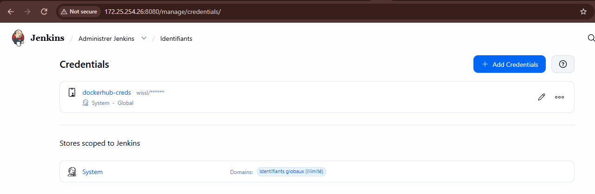
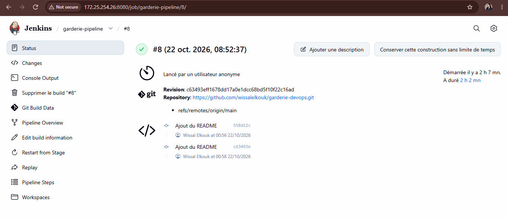
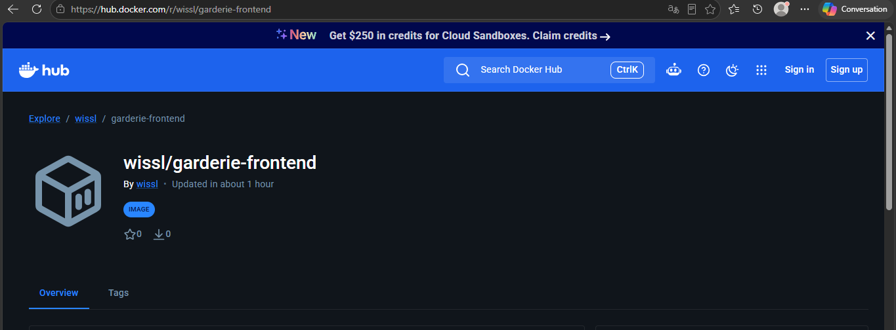
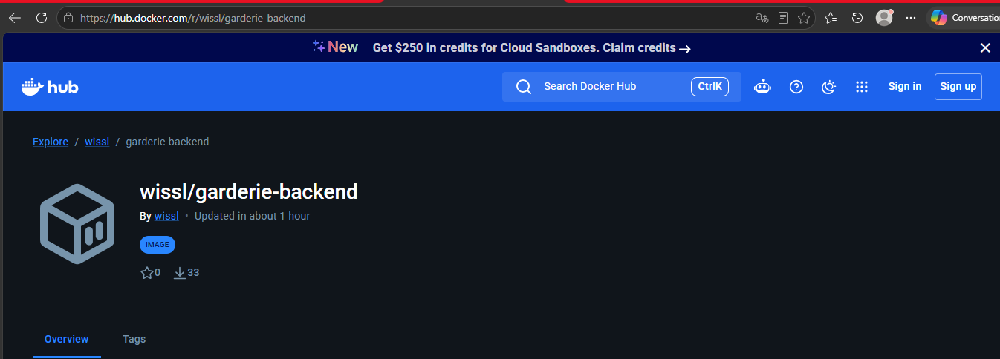

# Ma Garderie – Garderie DevOps

Site web d'une garderie d'enfants avec une chaîne CI/CD complète : le code est récupéré depuis GitHub, testé et construit en images Docker par Jenkins, publié sur Docker Hub, puis déployé dans une VM créée avec Vagrant, provisionnée par Ansible et lancée avec Docker Compose.

Projet de l'épreuve pratique **Master DevOps & Cloud**.

Dépôt : https://github.com/wissalelkouk/garderie-devops

## Sommaire

1. [Présentation de l'application](#1-présentation-de-lapplication)
2. [Technologies](#2-technologies)
3. [Architecture du projet](#3-architecture-du-projet)
4. [Prérequis](#4-prérequis)
5. [Lancer le projet en local](#5-lancer-le-projet-en-local)
6. [Docker et Docker Compose](#6-docker-et-docker-compose)
7. [Pipeline CI/CD Jenkins](#7-pipeline-cicd-jenkins)
8. [Images Docker Hub](#8-images-docker-hub)
9. [Création et provisioning de la VM](#9-création-et-provisioning-de-la-vm)
10. [Déploiement avec Docker Compose](#10-déploiement-avec-docker-compose)
11. [Accès à l'application déployée](#11-accès-à-lapplication-déployée)
12. [Tests](#12-tests)
13. [Captures d'écran](#13-captures-décran)
14. [Dépannage](#14-dépannage)
15. [Sécurité](#15-sécurité)
16. [Améliorations prévues](#16-améliorations-prévues)
17. [Auteure](#17-auteure)

---

## 1. Présentation de l'application

**Ma Garderie** est une landing page responsive composée de trois composants Next.js, alimentée dynamiquement par une API Express.

| Composant | Rôle |
|---|---|
| **Navbar** | Logo, nom de la garderie et menu de navigation |
| **Hero** | Image, titre de bienvenue, description, adresse, téléphone et horaires |
| **Services** | Cartes des services proposés par la garderie |

### API REST (backend Express, port 5000)

| Route | Description |
|---|---|
| `GET /api/garderie` | Informations générales de la garderie |
| `GET /api/services` | Liste des services proposés |
| `GET /api/activites` | Liste des activités |

Le frontend appelle `/api/...` ; Next.js redirige ces appels vers le backend grâce à `rewrites` dans `next.config.mjs`. L'adresse du backend est donnée par la variable `BACKEND_URL` (par défaut `http://backend:5000` dans Docker).

---

## 2. Technologies

| Domaine | Outil |
|---|---|
| Frontend | Next.js 16, React |
| Backend | Node.js 20, Express, CORS |
| Tests | Jest, Testing Library |
| Conteneurisation | Docker (image de base `node:20-alpine`), Docker Compose |
| Intégration continue | Jenkins (pipeline déclaratif, `Jenkinsfile`) |
| Registre d'images | Docker Hub |
| Infrastructure | Vagrant (Hyper-V), Ubuntu Server |
| Provisioning | Ansible (rôle `docker`) |
| Versionnage | Git / GitHub |

---

## 3. Architecture du projet

### Architecture applicative

```
┌──────────────┐     HTTP      ┌──────────────┐
│   Frontend   │ ────────────► │   Backend    │
│  Next.js     │  BACKEND_URL  │  Express     │
│  port 3000   │               │  port 5000   │
└──────────────┘               └──────────────┘
```

### Architecture de la chaîne CI/CD

```
GitHub ──► Jenkins ──► Install ► Test ► Build ► Push ──► Docker Hub
                                                             │
                              Vagrant (VM Ubuntu) ◄──────────┘
                              Ansible : installe Docker
                              Docker Compose : déploie les images
```

### Structure du projet

```
garderie-devops/
├── backend/
│   ├── server.js            # Point d'entrée de l'API
│   ├── package.json
│   ├── package-lock.json
│   ├── Dockerfile           # Image du backend (port 5000)
│   └── .dockerignore
├── frontend/
│   ├── app/                 # Pages et routes Next.js
│   ├── components/
│   │   ├── Hero.js          # Bannière d'accueil
│   │   ├── Navbar.js        # Barre de navigation
│   │   └── Services.js      # Présentation des services
│   ├── public/              # Fichiers statiques (images)
│   ├── __tests__/           # Tests Jest
│   ├── jest.config.js
│   ├── next.config.mjs
│   ├── package.json
│   ├── Dockerfile           # Image du frontend (port 3000)
│   └── .dockerignore
├── ansible/                 # Inventaire, site.yml, roles/docker
├── screenshots/             # Captures d'écran
├── Jenkinsfile              # Définition du pipeline CI/CD
├── Vagrantfile              # VM Ubuntu
├── docker-compose.yml       # Lancement des deux services
├── .gitignore
└── README.md
```

---

## 4. Prérequis

- Node.js 20 et npm (développement local)
- Docker et Docker Compose
- Git
- Un compte Docker Hub (publication des images)
- Jenkins avec le plugin Pipeline, et un accès au démon Docker
- Vagrant et Hyper-V (création de la VM)

---

## 5. Lancer le projet en local

### Backend

```bash
cd backend
npm install
npm start
```

L'API écoute sur http://localhost:5000.

### Frontend

```bash
cd frontend
npm install
BACKEND_URL=http://localhost:5000 npm run dev
```

Sous Windows (PowerShell) :

```powershell
$env:BACKEND_URL="http://localhost:5000"; npm run dev
```

Le site est disponible sur http://localhost:3000.

### Build de production du frontend

```bash
cd frontend
npm run build
npm start
```

---

## 6. Docker et Docker Compose

### Avec Docker Compose (recommandé)

```bash
docker compose up --build -d
docker ps
```

- Frontend : http://localhost:3000
- API : http://localhost:5000/api/services

Arrêt : `docker compose down`. Les deux services communiquent sur le réseau Docker `garderie-net`.

### Construire les images à la main

```bash
docker build -t wissl/garderie-backend:latest ./backend
docker build -t wissl/garderie-frontend:latest ./frontend
```

Le frontend accepte l'argument de build `BACKEND_URL` :

```bash
docker build --build-arg BACKEND_URL=http://backend:5000 -t wissl/garderie-frontend:latest ./frontend
```

### Dockerfile backend

- Part de `node:20-alpine`.
- Copie `package*.json`, puis installe les dépendances de production (`npm install --omit=dev`).
- Copie le code, expose le port 5000 et démarre avec `npm start`.

### Dockerfile frontend

- Part de `node:20-alpine`.
- Installe les dépendances (`npm install`).
- Définit `BACKEND_URL`, puis compile avec `npm run build`.
- Expose le port 3000 et démarre avec `npm start`.

---

## 7. Pipeline CI/CD Jenkins

Le pipeline est décrit dans le `Jenkinsfile` à la racine du dépôt (Pipeline as Code).

| # | Stage | Rôle |
|---|---|---|
| 1 | Checkout | Récupère le code depuis GitHub (branche `main`). |
| 2 | Install | Configure npm (timeouts et tentatives) puis installe les dépendances du frontend. |
| 3 | Test | Exécute `npm test` : vérifie l'affichage du titre « Ma Garderie ». Le pipeline s'arrête si le test échoue. |
| 4 | Build Frontend | `docker build` de l'image `wissl/garderie-frontend:latest`. |
| 5 | Build Backend | `docker build` de l'image `wissl/garderie-backend:latest`. |
| 6 | Push Frontend | Connexion à Docker Hub, puis `docker push` de l'image frontend. |
| 7 | Push Backend | `docker push` de l'image backend. |
| Post | Post Actions | `docker logout` pour ne pas laisser d'identifiants sur la machine. |

Si un stage échoue, les stages suivants sont ignorés (`skipped due to earlier failure`).

### Identifiants Docker Hub dans Jenkins

Le pipeline utilise un credential Jenkins de type **Username with password**, identifiant `dockerhub-creds` (variable `DOCKERHUB_CREDS` dans le `Jenkinsfile`) :

- **Username** : le nom d'utilisateur Docker Hub (`wissl`)
- **Password** : un *Personal Access Token* Docker Hub avec les droits Read & Write

Pour créer un token : Docker Hub → Account Settings → Personal access tokens. Aucun identifiant n'est écrit dans le code.



### Réglages npm contre les coupures réseau

Le pipeline applique ces réglages avant `npm install` :

```
npm config set fetch-timeout 600000
npm config set fetch-retries 5
npm config set fetch-retry-mintimeout 20000
```

### Instructions d'exécution du pipeline

1. Ouvrir Jenkins (`http://<IP_JENKINS>:8080`).
2. Créer un job de type **Pipeline** nommé `garderie-pipeline`.
3. Dans *Pipeline*, choisir **Pipeline script from SCM**, SCM **Git**, URL `https://github.com/wissalelkouk/garderie-devops.git`, branche `*/main`, Script Path `Jenkinsfile`.
4. Ajouter les credentials `dockerhub-creds` (*Manage Jenkins → Credentials*).
5. Cliquer sur **Lancer un build**, puis suivre l'avancement dans **Console Output**.

Prérequis sur la machine Jenkins : Docker, Node.js, npm et Git installés, avec l'utilisateur `jenkins` membre du groupe `docker`.

### Résultat : pipeline exécuté avec succès

Le build **#8** s'est terminé en **SUCCESS** : les 7 étapes se sont exécutées jusqu'à la publication des deux images (`Finished: SUCCESS`).

- Date : 22 octobre 2026
- Source : dépôt GitHub, branche `main`
- Durée : environ 2 h (connexion réseau lente pour `npm install` et l'envoi des images)



---

## 8. Images Docker Hub

| Image | Description | Lien |
|---|---|---|
| `wissl/garderie-frontend` | Site Next.js (port 3000) | https://hub.docker.com/r/wissl/garderie-frontend |
| `wissl/garderie-backend` | API Express (port 5000) | https://hub.docker.com/r/wissl/garderie-backend |

```bash
docker pull wissl/garderie-frontend:latest
docker pull wissl/garderie-backend:latest
```

**Frontend**



**Backend**



---

## 9. Création et provisioning de la VM

> Section à compléter après l'exécution de `vagrant up` et du provisioning Ansible.

### Vagrant (branche `feature/vagrant`)

| Caractéristique | Valeur |
|---|---|
| Système | Ubuntu Server (box `generic/ubuntu2204`) |
| RAM | 2 Go |
| CPU | 2 vCPU |
| Réseau | Privé, IP fixe visée `192.168.56.10` |
| Provider | Hyper-V |

```powershell
# PowerShell en administrateur
vagrant up --provider=hyperv
vagrant status
vagrant ssh
```

### Ansible (branche `feature/ansible`)

Structure : un inventaire, le playbook `site.yml` et le dossier `roles/`.

Le rôle `docker` :

1. installe Docker Engine ;
2. installe le plugin Docker Compose ;
3. démarre et active le service Docker ;
4. autorise l'utilisateur de déploiement à exécuter Docker.

Le playbook `site.yml` applique ce rôle sur la VM ; Vagrant l'exécute pendant le provisioning (`ansible_local`).

---

## 10. Déploiement avec Docker Compose

> Section à compléter après le déploiement dans la VM.

Le fichier `docker-compose.yml` de déploiement (branche `feature/deployment`) utilise directement les images Docker Hub, **sans reconstruction locale** :

```yaml
services:
  backend:
    image: wissl/garderie-backend:latest
    ports:
      - "5000:5000"
    networks:
      - garderie-net
  frontend:
    image: wissl/garderie-frontend:latest
    ports:
      - "3000:3000"
    environment:
      - BACKEND_URL=http://backend:5000
    depends_on:
      - backend
    networks:
      - garderie-net
networks:
  garderie-net:
```

Dans la VM :

```bash
docker compose pull
docker compose up -d
docker ps
curl http://localhost:5000/api/garderie
curl http://localhost:5000/api/services
curl http://localhost:5000/api/activites
```

---

## 11. Accès à l'application déployée

> À compléter avec l'IP réelle de la VM.

`http://<IP_DE_LA_VM>:3000`

---

## 12. Tests

Les tests du frontend utilisent Jest et Testing Library. Le test vérifie l'affichage du titre « Ma Garderie » dans la Navbar.

```bash
cd frontend
npm test
```

---

## 13. Captures d'écran

| Capture | Fichier | Statut |
|---|---|---|
| Pipeline Jenkins réussi | `screenshots/jenkins-pipeline-success.png` | ✅ |
| Identifiants Jenkins | `screenshots/jenkins-credentials.png` | ✅ |
| Image frontend Docker Hub | `screenshots/dockerhub-frontend.png` | ✅ |
| Image backend Docker Hub | `screenshots/dockerhub-backend.png` | ✅ |
| VM démarrée avec Vagrant | `screenshots/vagrant-up.png` | à faire |
| Playbook Ansible réussi | `screenshots/ansible-playbook.png` | à faire |
| Conteneurs en cours d'exécution | `screenshots/docker-ps.png` | à faire |
| Application dans le navigateur (autre machine) | `screenshots/application.png` | à faire |

---

## 14. Dépannage

### `npm error code ECONNRESET` ou `ERR_SOCKET_TIMEOUT` pendant `npm install`

Connexion coupée vers le registre npm (réseau lent ou instable).

- Relancer le build (les couches déjà en cache ne sont pas refaites).
- Garder les réglages `fetch-retries` / `fetch-timeout` ci-dessus.
- Tester la connexion : `npm ping` et `curl -I https://registry.npmjs.org`.
- Vérifier le proxy ou le DNS de la machine (ex. `"dns": ["8.8.8.8", "1.1.1.1"]` dans `/etc/docker/daemon.json`).

### `unauthorized: incorrect username or password` au `docker login`

- Le credential Jenkins est faux, expiré ou le token n'a pas les bons droits.
- Si la 2FA est activée sur Docker Hub, il faut obligatoirement un *Personal Access Token*.
- Tester à la main : `echo "<TOKEN>" | docker login -u wissl --password-stdin`.

### `unauthorized: authentication required` pendant `docker pull`

Le jeton temporaire expire quand le téléchargement est trop lent. Relancer la commande : Docker conserve les couches déjà téléchargées.

```powershell
do { docker pull jenkins/jenkins:lts-jdk17; $ok = $?; if (-not $ok) { Start-Sleep 3 } } until ($ok)
```

### `net/http: timeout awaiting response headers` pendant `docker push`

Une grosse couche n'a pas pu être envoyée avant le timeout.

- Relancer la commande : Docker ne renvoie pas les couches déjà poussées.
- Limiter les envois parallèles dans `/etc/docker/daemon.json` : `{ "max-concurrent-uploads": 1 }`, puis `sudo systemctl restart docker`.
- Alléger l'image (`.dockerignore`, build multi-étapes).

### Le frontend plante au démarrage (erreur de police Google)

Le layout généré par défaut télécharge les polices Geist depuis Google, ce qui échoue sans accès réseau. Le `layout.js` du projet n'utilise donc aucune police Google.

### Jenkins reconstruit une ancienne version

Jenkins clone le code depuis GitHub : penser à `git commit` et `git push` avant de lancer un build.

### L'IP de la VM Jenkins a changé

Avec Hyper-V, l'adresse change selon le réseau ou au redémarrage. Utiliser l'IP actuelle (`hostname -I` dans la VM).

---

## 15. Sécurité

- Ne jamais écrire de mot de passe ou de token dans le code, le `Jenkinsfile` ou ce README : utiliser les Credentials Jenkins.
- Si un token a été exposé (conversation, capture d'écran, dépôt), le révoquer immédiatement et en créer un nouveau.
- Ajouter `node_modules`, `.next`, `.env` et `.vagrant` aux fichiers `.dockerignore` et `.gitignore`.
- Activer l'authentification sur Jenkins si le serveur est accessible depuis l'extérieur.

---

## 16. Améliorations prévues

- Dockerfile frontend multi-étapes avec `output: 'standalone'` (image de ~150-250 Mo au lieu de plus d'1 Go).
- Remplacer `npm install` par `npm ci` dans les Dockerfiles pour des builds reproductibles.
- Ajouter `retry` et `timeout` autour des pushs dans le `Jenkinsfile`.
- Tags de version (numéro de build ou hash du commit) en plus de `latest`.
- Déploiement automatique depuis Jenkins (SSH ou Ansible vers la VM).

---

## 17. Auteure

Wissal El Kouk — Dépôt : https://github.com/wissalelkouk/garderie-devops
